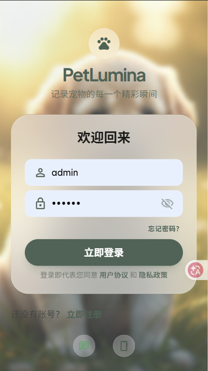
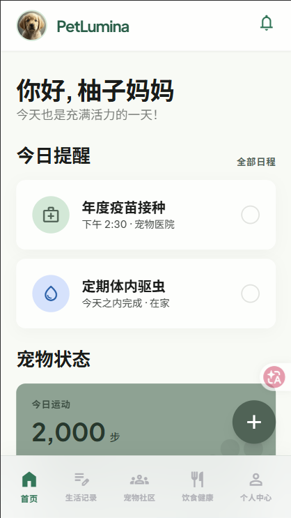
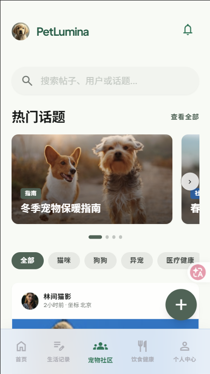
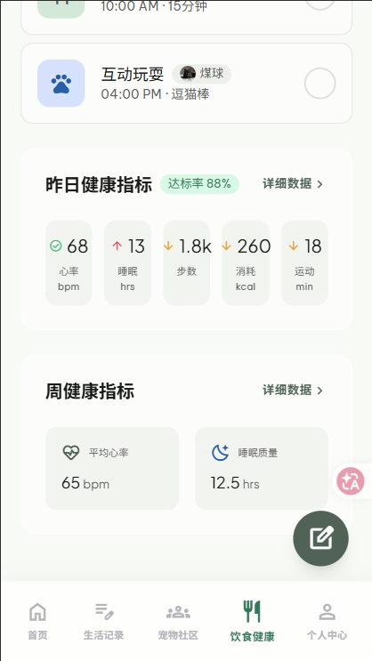
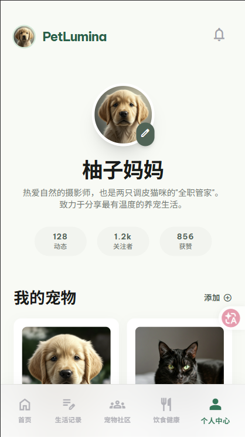

<div align="center">

# PetLumina - 宠物生活管理平台

<p align="center">
  
  
  
  
  
  
  
  
</p>

**三端架构：移动端 App + Web 管理后台 + 后端服务**

<br />

</div>

## 项目概述

PetLumina 是一个面向宠物主人的智能生活管理与社区互动平台，包含：

| 端 | 路径 | 技术栈 | 说明 |
|---|---|---|---|
| **移动端** | `pet-lumina-app/` | Vue 3 + Vant 4 + Tailwind CSS | 宠物主人使用的移动 Web App |
| **管理后台** | `pet-lumina-web/` | Vue 3 + Element Plus + ECharts + Tailwind CSS | 管理员使用的 Web 后台 |
| **后端服务** | `backend/` | Spring Boot 2.7 + MyBatis-Plus + Sa-Token + Redis | RESTful API 服务 |

## 页面预览

### 移动端

<div align="center">

| 登录页 | 首页 | 生活记录 |
|:---:|:---:|:---:|
|  |  |  |

| 宠物社区 | 饮食健康 | 个人中心 |
|:---:|:---:|:---:|
|  |  |  |

</div>

## 核心功能

### 移动端 (pet-lumina-app)

| 模块 | 能力说明 |
| --- | --- |
| **首页仪表盘** | 宠物状态概览、今日提醒、快捷操作入口、社区动态流 |
| **生活记录** | 图文记录宠物日常、标签分类、图片轮播、分享功能 |
| **宠物社区** | 话题浏览与发布、帖子详情、评论互动、点赞收藏、用户关注 |
| **健康管理** | 健康数据录入、周度指标追踪、健康计划制定、趋势可视化 |
| **日程提醒** | 提醒创建与管理、按日期分组、通知中心 |
| **个人中心** | 用户资料编辑、宠物档案管理、账号安全、通用设置 |
| **认证系统** | 登录、注册、密码重置、验证码校验 |

### 管理后台 (pet-lumina-web)

| 模块 | 能力说明 |
| --- | --- |
| **数据概览** | 用户/宠物/帖子统计、活跃趋势折线图、宠物类型分布饼图、热门帖子/话题 |
| **用户管理** | 搜索筛选、角色/状态过滤、查看详情(宠物+帖子)、禁用/启用 |
| **宠物管理** | 全局宠物列表、搜索筛选、删除 |
| **帖子管理** | 帖子列表、图片缩略图、类别筛选、删除 |
| **评论管理** | 评论列表、搜索、删除 |
| **生活记录** | 记录列表、类型筛选、删除 |
| **话题管理** | 话题 CRUD、类别筛选、新建/编辑对话框 |
| **健康数据** | 健康记录列表、心情筛选、详情抽屉(趋势图+历史表) |
| **通知管理** | 通知列表、已读/未读状态 |

### 后端 API (backend)

| 模块 | 接口数 | 说明 |
| --- | --- | --- |
| **认证** | 6 | 登录/注册/验证码/密码重置/登出/当前用户 |
| **用户** | 6 | 资料查询/更新/头像/密码/分页列表 |
| **宠物** | 6 | CRUD + 用户宠物列表 |
| **帖子** | 7 | CRUD + 点赞/收藏 |
| **评论** | 3 | 添加/删除/分页列表 |
| **话题** | 7 | CRUD + 关注/帖子列表 |
| **关注** | 3 | 关注/粉丝/关注列表 |
| **健康** | 8 | 数据录入/计划/周报/Dashboard |
| **提醒** | 6 | CRUD + 完成状态切换 |
| **通知** | 4 | 列表/未读数/标记已读 |
| **生活记录** | 5 | CRUD + 分页列表 |
| **文件** | 2 | 通用上传/图片上传 |
| **管理端** | 14 | 用户/宠物/帖子/评论/话题/记录/健康数据管理 + Dashboard统计 |

## 快速开始

### 环境要求

- Node.js 18+
- Java 8+
- MySQL 8.0+
- Redis 6.0+

### 后端启动

```bash
cd backend

# 1. 创建数据库并执行初始化脚本
mysql -u root -p < sql/init.sql

# 2. (可选) 导入开发种子数据
mysql -u root -p petlumina < sql/seed.sql

# 3. 修改数据库连接配置
# src/main/resources/application-dev.yml

# 4. 启动
mvn spring-boot:run
```

**种子数据账号：**
| 角色 | 手机号 | 密码 |
|---|---|---|
| 管理员 | 13800000001 | 123456 |
| 普通用户 | 13800000002 ~ 13800000007 | 123456 |

### 移动端启动

```bash
cd pet-lumina-app
npm install
npm run dev        # http://localhost:5173
```

### 管理后台启动

```bash
cd pet-lumina-web
npm install
npm run dev        # http://localhost:3000
```

## 项目结构

```text
ai-PetShop/
├── backend/                    # Spring Boot 后端
│   ├── sql/                    # 数据库脚本 (init.sql + seed.sql)
│   └── src/main/java/com/petlumina/backend/
│       ├── annotation/         # 自定义注解 (@AuthCheck, @RateLimiter)
│       ├── aop/                # AOP 切面 (权限校验, 限流)
│       ├── common/             # 通用类 (BaseResponse, PageRequest)
│       ├── config/             # 配置 (CORS, Sa-Token, MyBatis-Plus, Redis)
│       ├── controller/
│       │   ├── user/           # 用户端 API (12个)
│       │   └── admin/          # 管理端 API (8个)
│       ├── service/
│       │   ├── user/           # 用户端 Service (14个)
│       │   └── admin/          # 管理端 Service
│       ├── model/              # 实体/DTO/VO
│       ├── mapper/             # MyBatis-Plus Mapper
│       ├── manager/            # 第三方服务管理 (COS, Sa-Token)
│       ├── exception/          # 异常处理
│       └── utils/              # 工具类
│
├── pet-lumina-app/             # 移动端 Vue App
│   └── src/
│       ├── api/                # 接口请求层 (10个模块)
│       ├── components/         # 业务组件
│       ├── views/              # 页面组件
│       ├── stores/             # Pinia 状态管理
│       ├── router/             # 路由配置
│       └── types/              # TypeScript 类型
│
├── pet-lumina-web/             # 管理后台 Vue App
│   └── src/
│       ├── api/                # 接口请求层 (11个模块)
│       ├── layout/             # 布局组件 (Sidebar, Header)
│       ├── views/              # 页面组件 (11个)
│       ├── components/         # 通用组件
│       ├── stores/             # Pinia 状态管理
│       └── types/              # TypeScript 类型
│
└── z-plan/                     # 开发计划文档
```

## 技术架构

### 后端

- **核心框架**: Spring Boot 2.7 + JDK 8
- **ORM**: MyBatis-Plus 3.5.9 (BaseMapper + IService)
- **认证**: Sa-Token 1.39.0 (角色权限 + 路由拦截)
- **缓存**: Redis + Redisson (验证码/限流)
- **序列化**: Jackson (Long→String 防精度丢失)
- **文件存储**: 腾讯云 COS
- **响应格式**: `BaseResponse<T>` (code=0 成功)
- **ID 策略**: 雪花算法 (Long 类型)

### 移动端

- **核心框架**: Vue 3.5 (Composition API + `<script setup>`) + Vite 6
- **UI 组件库**: Vant 4 (移动端)
- **样式方案**: Tailwind CSS 3 + Material Design 3 色彩令牌
- **路由**: Vue Router 4 (Hash 模式，适配 5+App)

### 管理后台

- **核心框架**: Vue 3.5 + TypeScript + Vite 6
- **UI 组件库**: Element Plus 2.x (表格/分页/标签等)
- **样式方案**: Tailwind CSS 4 + 毛玻璃效果 (glass-panel)
- **图表**: ECharts 5 + vue-echarts
- **图标**: Material Symbols Outlined
- **字体**: Plus Jakarta Sans + Noto Sans SC

## 更新日志

### v2.1 (2026-06-03)

**后端目录重构**
- controller/service 按 user/ 和 admin/ 子目录重构
- 新建管理端 API (8个 Controller + DashboardService)
- 管理端接口统一 @AuthCheck(mustRole="admin") 权限校验

**Web 管理后台**
- 从零搭建 pet-lumina-web 项目
- 实现 11 个管理页面 (登录/Dashboard/用户/宠物/帖子/评论/记录/话题/健康/通知)
- 毛玻璃 + Material Design 3 设计风格
- 搜索筛选、分页、CRUD、详情抽屉、统计图表

### v2.0 (2026-06-02)

**后端开发**
- Spring Boot 后端全部业务模块 (12个 Controller, 55个接口)
- Sa-Token 认证 + 角色权限
- MySQL 建表脚本 + 开发种子数据

**前端对接**
- 新建 API 层 (10个业务模块)
- 重构 20+ 页面组件接入真实 API
- 全局路由守卫、类型系统完善

### v1.0 (2026-05-01)

**基础工程搭建**
- Vue 3 + Vite + TypeScript 项目初始化
- Tailwind CSS 设计系统 (Material Design 3 色彩)
- 全部移动端页面开发 (7大模块)
- HBuilder APK 打包适配

---

<div align="center">
  <p>内部项目 | 持续迭代中</p>
</div>
