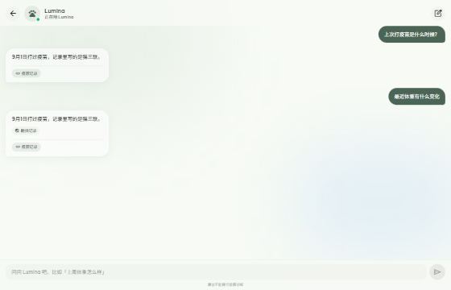

# 交付报告：App 对话页接入（Web）

- 日期：2026-11-07
- 里程碑：S1.5-Web（聊天页 + SSE 客户端 + 端到端）
- 关联提交：`55e9f1e`（标签 `v2.10-agent-web`）
- 结论：**可交付**（浏览器端到端已走通；E2E 为人工驱动，未脚本化）

## 1. 环境

| 项 | 值 |
| --- | --- |
| Node | v24.10.0 |
| Vitest | 5.1.0 |
| 浏览器 | Microsoft Edge（自动化面板驱动） |
| 服务 | stub_java:8097 / stub_llm:8098 / uvicorn:8099 / vite:5173 |
| 测试账号 | `13800000001 / 123456` |

## 2. 做了什么（文件级）

| 文件 | 职责 | 行数（约） |
| --- | --- | --- |
| `pet-lumina-app/src/api/sse.ts` | 纯 SSE 解析器（`push`/`flush`，多行 data、CRLF、注释行） | 82 |
| `pet-lumina-app/src/api/agent.ts` | `streamChat` / `replayRun` / `fetchSessionMessages` + 5 个类型守卫 | ~150 |
| `pet-lumina-app/src/types/agent.ts` | 事件/气泡/引用类型（id 一律 string） | ~60 |
| `pet-lumina-app/src/utils/chatStream.ts` | `applyAgentEvent` 归约器 + `historyToBubbles` | ~70 |
| `pet-lumina-app/src/views/chat/ChatView.vue` | 全屏对话页（流式光标、工具 chip、引用回跳、重试、输入法保护） | ~330 |
| `pet-lumina-app/src/router/index.ts` | 新增 `/chat` 路由 | +1 |
| `pet-lumina-app/src/layout/MainLayout.vue` | 对话页收起底部导航 | +3 |
| `pet-lumina-app/src/views/home/Home.vue` | 「问 Lumina」入口卡 | +18 |
| `pet-lumina-app/src/locales/{zh-CN,en-US,ja-JP}.json` | `chat.*` 共 17 键 × 3 语言 | +51 |
| `pet-lumina-app/src/components/home/PetStatusBento.vue` | 字段缺失兜底（`?? 0`） | 2 |
| `pet-lumina-app/.env.development` | `VITE_AGENT_BASE_URL` | +2 |
| `pet-lumina-app/package.json` | `test: vitest run` + `vitest` 依赖 | +2 |

## 3. 验证（命令 + 真实输出）

### 3.1 类型检查 + 构建

```text
PS D:\project\dsh\aiPetShop\pet-lumina-app> npm run build
dist/assets/ChatView-BxD4GDo_.js   ~10.9 kB
✓ built in 7.25s
BUILD_EXIT=0
```

`vue-tsc -b` 是构建的一部分，所以**类型错误会直接阻断构建**（这条路径此前的隐患已在文档 §13 记录）。

### 3.2 前端单测

```text
PS> npx vitest run
 ✓ src/api/sse.spec.ts (10 tests) 14ms
 ✓ src/utils/chatStream.spec.ts (10 tests) 10ms
 Test Files  2 passed (2)
      Tests  20 passed (20)
VITEST_EXIT=0
```

覆盖：跨 chunk 拼接、多行 `data`、CRLF、注释行、`flush` 残片、非数字 `id`、空记录；归约器的 route/tool/delta/done/error 五分支 + 历史过滤。

### 3.3 浏览器端到端

| 步骤 | 观察到的结果 |
| --- | --- |
| 打开 `/#/login`，用测试账号登录 | 跳转 `/#/home` |
| 首页 | 欢迎语、今日提醒、宠物状态（`4,200 步`、`2/3 次`、`92 卓越`）、「问 Lumina」入口卡 |
| 点入口卡 | 进入 `/#/chat`，底部导航收起，输入框完整可见 |
| 点建议问题「上次打疫苗是什么时候？」 | 用户气泡 → 助手气泡流式出字 → 工具 chip「翻找记录」→ 引用 chip「疫苗记录」 |
| 手动输入「最近体重有什么变化」并 Enter | 同上，新增一轮问答 |
| 刷新页面（`?fresh=N#/chat`） | 历史 4 条正确回读，顺序一致 |



## 4. 本轮抓到的真实缺陷

| 缺陷 | 根因 | 修复 |
| --- | --- | --- |
| 首页整页白屏 | `PetStatusBento` 模板 `pet.todaySteps.toLocaleString()`，桩数据缺字段 → Vue 渲染异常带走整棵树 | `(pet.todaySteps ?? 0)` + `stepPercentage` 兜底 |
| 输入框不可见 | `ChatView` 的 `fixed bottom-0` 撞上 `z-50` 的胶囊导航 | 对话页隐藏导航 |
| 诊断被误导 | `#` 路由跳转不重载页面，错误覆盖层一直残留 | 用 `?fresh=N#/chat` 强制整页刷新 |

## 5. 已知缺口与风险

| 缺口 | 影响 | 计划 |
| --- | --- | --- |
| 浏览器 E2E 未脚本化 | 回归依赖人工 | 后续用 Playwright 固化 W1/W4/W7 |
| 无 `ChatView` 组件级单测 | 模板分支靠人工看 | 补 `@vue/test-utils` 用例 |
| 无「停止生成」按钮 | 长回答只能等 | 接入 `AbortController` 的显式入口 |
| 工具 chip 文案 | 未知工具回落 `generic` | 新增工具时同步 i18n |
| 多会话列表 | 只有单会话（localStorage 一个 id） | S2 做会话切换 |

## 6. 结论

**可交付**：构建、单测、浏览器端到端三层证据齐全；两个真 bug 已修且有回归说明。
下一步建议：管理端会话工作台（把 `agent_run/step/tool_call_log` 变成可视证据）。
