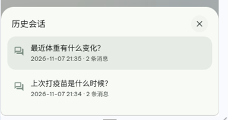

# 交付报告：App 历史会话（BACKLOG A2）

- 日期：2026-11-08
- 范围：`GET /agent/sessions` + App 聊天页「历史会话」面板
- 结论：**可交付**。后端 146 项测试、前端 build/vitest、真机 + 浏览器端到端均通过。

## 1. 问题

`ChatView.vue` 只把当前会话 id 存在 `localStorage['petlumina-agent-session']`：用户关掉页面、换了设备，之前的对话就"消失"了——数据其实还在 `agent_session` 表里，只是**没有任何接口能列出来**。

BACKLOG 里这一条被标为 P0，因为它挡住的不是"锦上添花"，而是"聊天记录到底存没存"这件事的可验证性。

## 2. 改动

| 文件 | 改动 | 说明 |
| --- | --- | --- |
| `backend-agent/app/api/schemas.py` | 新增 `SessionItemOut`、`SessionListOut` | 对外载荷不含 `user_id` |
| `backend-agent/app/api/routes.py` | 新增 `GET /agent/sessions`（page/page_size） | 复用 `list_sessions`，`user_id` 来自 token |
| `backend-agent/app/storage/memory.py` | `list_sessions` 排序键改为 `(last_active, id)` | 修掉同秒会话顺序问题，见 §4 D1 |
| `backend-agent/tests/test_sessions_api.py` | 新增 4 条契约测试 | 401 / 排序 / 用户隔离 / 分页与消息数 |
| `pet-lumina-app/src/api/agent.ts` | 新增 `fetchSessions(page, pageSize)` | 与其它接口同一套 `assertOk` 与错误码 |
| `pet-lumina-app/src/types/agent.ts` | 新增 `AgentSessionItem`、`AgentSessionPage` | id 一律 string（19 位雪花号） |
| `pet-lumina-app/src/views/chat/ChatView.vue` | 顶栏「历史会话」按钮 + 底部面板 | 打开即拉取；选中后清空气泡再回读 |
| `pet-lumina-app/src/locales/{zh-CN,en-US,ja-JP}.json` | `chat.history*`、`chat.messageCount` 共 4 键 × 3 语 | 文案不硬编码 |

设计取舍：

1. **不新增 `GET /agent/sessions/{id}`**：详情仍走已有的 `/messages`，少一个接口就少一套鉴权分支。
2. **列表页不返回 `user_id`**：前端列表里显示"用户 1001"没有意义，反而把内部 id 暴露到浏览器。
3. **面板每次打开都重拉**：会话是会被不断创建的，缓存一份只会显示过期列表；一次查询 20 条，成本可以忽略。
4. **切换会话时先清空 `bubbles`**：不等请求回来再覆盖，避免旧会话消息与新会话消息短暂混在一屏。

## 3. 验收证据

| 项 | 命令 | 结果 |
| --- | --- | --- |
| 后端 lint | `.venv\Scripts\python -m ruff check .` | `All checks passed!` |
| 后端测试 | `PET_AGENT_TEST_MYSQL_DSN=... python -m pytest` | **146 passed in 3.80s** |
| 评测 | `python -m evals.run` | routing 15/15、safety 6/6、memory 2/2 |
| 前端类型检查 | `npx vue-tsc -b` | `TSC_EXIT=0` |
| 前端构建 | `npm run build` | `✓ built`（`ChatView-*.js` 14.45 kB） |
| 前端单测 | `npx vitest run` | **20 passed** |
| 真机接口 | `GET /agent/sessions`（token-0001） | `total=2`，两条标题分别为「最近体重有什么变化？」「上次打疫苗是什么时候？」，各 2 条消息 |
| 真机鉴权 | 无 token 请求 | `401` |
| 真机隔离 | 换 `token-2002` | `total=0`（看不到别人的会话） |

浏览器端到端（Edge，真进程 8097 stub / 8098 stub LLM / 8099 agent / 5173 vite）：

1. 登录 → 首页「问 Lumina」→ 对话页；
2. 发一条「上次打疫苗是什么时候？」；
3. 点「新会话」→ 发一条「最近体重有什么变化？」；
4. 点顶栏「历史会话」→ 面板列出 2 条，当前会话高亮、显示时间与「2 条消息」；
5. 点旧会话 → 面板关闭、标题与消息全部切换为该会话内容；
6. 整页刷新（`?fresh=a3#/chat`）→ 仍恢复到最后选中的会话。



## 4. 真实缺陷

| 编号 | 现象 | 根因 | 修法 |
| --- | --- | --- | --- |
| D1 | `test_lists_own_sessions_newest_first` 首次失败：`ids[0]` 是更早的会话 | 内存版按**字符串时间**倒序，同秒创建的两个会话时间相同，稳定排序保留了插入顺序（旧的在前） | 排序键改 `(last_active, session.id)`，与 MySQL 的 `ORDER BY last_message_time DESC, id DESC` 对齐 |
| D2 | `ruff` 报 `I001`：`test_sessions_api.py` 的 conftest import 分成两行 | 手写 import 时拆成了两条 | 合并为一条 |

D1 值得单独说：这不是"测试写得挑剔"。真机上同一秒建两个会话完全可能（用户连点"新会话"），修之前列表会把刚建的排在后面。

## 5. 已知缺口

1. 只做了分页 API，前端**没有做"加载更多"**：目前一次取 20 条，超过 20 条的历史看不到（缺口登记在 BACKLOG）。
2. 没有删除/重命名会话的能力（B7 一并处理）。
3. 没有按宠物过滤（`pet_id` 已在载荷里，接口未提供筛选参数）。
4. 浏览器验收仍是手动流程，未纳入自动 e2e（BACKLOG C9）。
5. 会话标题取首条用户消息，超长未做截断策略（后端 `title` 原样返回，前端 `truncate` 显示）。

## 6. 复现

```powershell
cd backend-agent
$env:PET_AGENT_ENV="dev"; $env:PET_AGENT_REPO_BACKEND="memory"; $env:PET_AGENT_AUTH_MODE="backend"
$env:PET_AGENT_LLM_BASE_URL="http://127.0.0.1:8098/v1"; $env:PET_AGENT_LLM_MODEL="stub"
$env:PET_AGENT_BACKEND_BASE_URL="http://127.0.0.1:8097/api/v1"
.\.venv\Scripts\python -m uvicorn tests.stub_java:app --port 8097   # 另一个窗口
.\.venv\Scripts\python -m uvicorn tests.stub_llm:app --port 8098    # 另一个窗口
.\.venv\Scripts\python -m uvicorn app.main:app --port 8099
# 前端
cd ..\pet-lumina-app
$env:VITE_API_BASE_URL="http://127.0.0.1:8097/api/v1"; $env:VITE_AGENT_BASE_URL="http://127.0.0.1:8099"
npm run dev      # http://127.0.0.1:5173/#/chat
```
