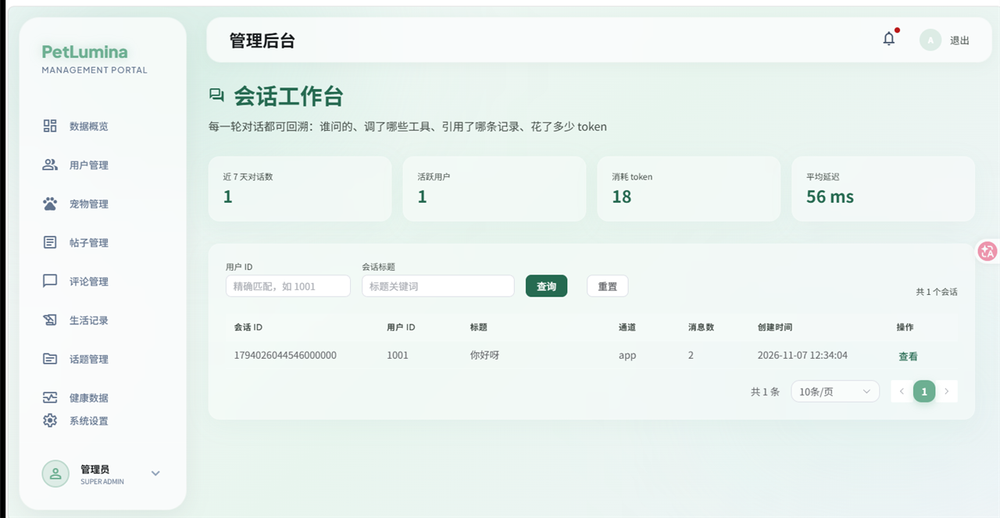
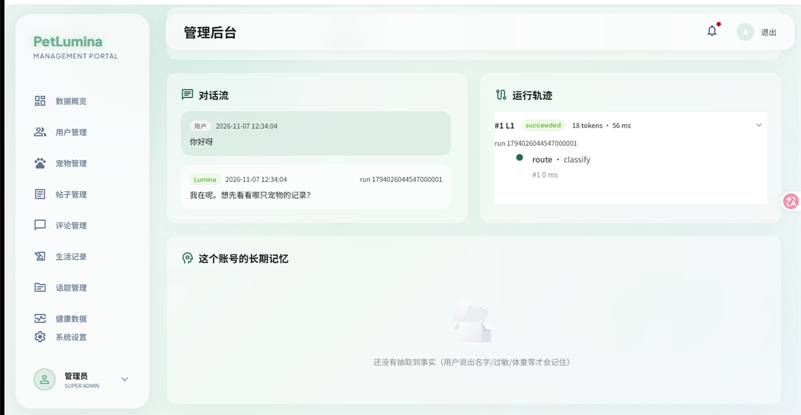

# 交付报告：S1.7 管理端「会话工作台」

- 日期：2026-11-08
- 计划：[s1.7-admin-workbench.md](../plans/s1.7-admin-workbench.md)（先于代码提交）
- 规格：[agent-runtime-api.md v1.3](../spec/agent-runtime-api.md)（6.3 管理端只读接口，I14–I15）
- 结论：**可交付**。真机 6/6 冒烟、101 个单测、浏览器端到端均已通过。

## 1. 环境

| 项 | 值 |
| --- | --- |
| OS / Shell | Windows 10 + PowerShell 5.1 |
| Python | 3.12.14（`backend-agent/.venv`） |
| Agent 运行时 | FastAPI + LangGraph，`127.0.0.1:8099`，`REPO_BACKEND=memory`、`AUTH_MODE=backend` |
| Java 后端 | 本地桩 `tests/stub_java.py:8097`（`/auth/current` 按 token 返回身份与角色） |
| LLM | 本地桩 `tests/stub_llm.py:8098`（`LLM_MODEL=stub`） |
| 前端 | `pet-lumina-web` dev server `127.0.0.1:3000`，`VITE_AGENT_BASE_URL=http://127.0.0.1:8099` |
| 浏览器 | Edge（真窗口，非 headless） |

## 2. 改动清单

| 层 | 文件 | 说明 |
| --- | --- | --- |
| 领域 | `backend-agent/app/domain/models.py` | `Session.message_count`；新增 `SessionSummary` / `RunDetail` / `DayUsage` / `UsageOverview` |
| 仓储协议 | `backend-agent/app/storage/base.py` | 新增 `list_sessions` / `get_session_any` / `list_runs` / `usage_overview`（注释写明仓储不做权限判断） |
| 内存实现 | `backend-agent/app/storage/memory.py` | 消息计数同步、四个查询、按最后活跃时间排序 |
| MySQL 实现 | `backend-agent/app/storage/mysql.py` | 同四个查询；`list_runs` 用 `WHERE run_id IN (...)` 批量取 step（避免 N+1） |
| 身份 | `backend-agent/app/api/deps.py` | `Identity.role` + `is_admin`；角色取自 Java `/auth/current`，忽略 `x-user-role`（dev 除外） |
| 接口 | `backend-agent/app/api/routes.py` | `_admin_identity` + 4 个 `/agent/admin/*` 只读接口 + `admin.access` 审计 |
| 报文 | `backend-agent/app/api/schemas.py` | `AdminSessionItem/List`、`AdminStepOut/RunOut/SessionDetail`、`AdminUsageOut`、`AdminMemoryOut` |
| 桩 | `backend-agent/tests/stub_java.py` | `token-admin` → `{"id":"9001","role":"admin"}`；`139` 开头手机号登录发 admin token |
| 测试 | `backend-agent/tests/test_admin.py` | 9 例：403/401、列表筛选、详情含 steps、404、审计与正文隔离、用量、记忆权限、伪造 header 无效 |
| 冒烟 | `backend-agent/scripts/admin_smoke.py` | 6 项真进程检查（非 TestClient） |
| 前端接口 | `pet-lumina-web/src/api/agent.ts` | 独立 axios 实例 + `satoken` 头 + `AgentApiError`；不复用 Java 信封拦截器 |
| 前端页面 | `pet-lumina-web/src/views/agent/SessionList.vue` | 用量卡 + 用户/标题筛选 + 表格分页 |
| 前端页面 | `pet-lumina-web/src/views/agent/SessionDetail.vue` | 对话流（含引用）+ 每 run 的 step 时间线 + 该账号长期记忆 |
| 前端路由 | `pet-lumina-web/src/router/index.ts` | `/agent/sessions`、`/agent/sessions/:id` |
| 前端菜单 | `pet-lumina-web/src/layout/Sidebar.vue` | 「会话工作台」入口 |

## 3. 验证证据

```text
ruff check .                    → All checks passed!
pytest                          → 101 passed in 1.52s
python -m scripts.admin_smoke   → 6/6 passed
npm run build (pet-lumina-web)  → ✓ built（vue-tsc --noEmit 通过）
```

`scripts.admin_smoke` 的真实输出（节选）：

```text
403 {'code': 'forbidden', 'message': '需要管理员权限'}
session=1794026044546000000 title=你好呀 messages=2
detail messages=2 runs=1 steps=1 kinds=['route']
usage {'runs': 1, 'users': 1, 'prompt_tokens': 11, 'completion_tokens': 7,
       'total_tokens': 18, 'avg_latency_ms': 56,
       'by_day': [{'day': '2026-11-07', 'runs': 1, 'tokens': 18}]}
no-token 401 unauthorized
```

浏览器端到端（Edge，管理员账号 `13900000000 / 123456`）：

| 步骤 | 结果 |
| --- | --- |
| 打开 `/#/agent/sessions` | 用量卡显示「近 7 天对话数 1 / 活跃用户 1 / 消耗 token 18 / 平均延迟 56 ms」 |
| 列表 | 一行：会话 `1794026044546000000`、用户 `1001`、标题「你好呀」、通道 app、消息数 2 |
| 点「查看」 | 详情页：对话流两条（用户「你好呀」/ Lumina 回答）、运行轨迹 `#1 L1 succeeded 18 tokens · 56 ms` |
| 展开 run | 出现 step：`route · classify #1 0 ms` |
| 长期记忆区 | 空状态文案「还没有抽取到事实（用户说出名字/过敏/体重等才会记住）」 |





## 4. 过程中修掉的真实缺陷

| # | 现象 | 根因 | 修法 |
| --- | --- | --- | --- |
| D1 | `test_admin.py` 报 `ImportError: attempted relative import with no known parent package` | 用了 `from .conftest import ...`，而测试不是包 | 改为 `from conftest import ...`（与其它测试一致） |
| D2 | `SyntaxError: invalid syntax` 指向 `routes.py` 某行 | `edit` 把装饰器与 `async def` 拼到同一行 | 拆回两行 |
| D3 | `ruff check` 失败 `I001`（import 排序） | 新文件 import 顺序 | `ruff check --fix` |
| D4 | `npm run build` 先报 `vue-tsc` 类型错误风险 | 新页面用到 `el-*` 组件与 `route.params.id` | `vue-tsc --noEmit` 全绿后继续；`params.id` 统一 `String(...)` |
| D5 | `vite build` 报 `remove C:\...\Temp\esbuild-xxx: Access is denied` | 系统临时目录被占用/权限异常 | 把 `TEMP`/`TMP` 指到工作区内目录后构建成功（构建通过，退出码 1 只是 npm 把 warning 写 stderr 触发 PowerShell `NativeCommandError`） |

## 5. 设计决策回顾

1. **权限只信 token 换来的角色**：请求头可伪造，`/auth/current` 是唯一真源；仓储层不做权限判断，避免"C 层有权限、D 层没有"的分裂。
2. **只读是产品决策**：不做管理员代发消息——代发会让"这条消息是谁说的"失真，记忆归属也会被污染。
3. **管理端前端独立 axios 实例**：Agent 是纯 REST（HTTP 状态码表达错误），套 Java 的 `{code,data,message}` 信封会把 403/404 误判成业务异常。
4. **列表按最后活跃时间排序**：运营关心"最近有人问什么"，而不是"谁最先注册"。
5. **详情页带记忆**：记忆错了能当场发现，这是 P1 记忆功能被运营真正使用的前提。

## 6. 已知缺口

1. `REPO_BACKEND=memory` 下验证；MySQL 版四个查询只经过契约测试，未在真 MySQL 上跑（本机无 mysql）。
2. 无分页游标，深分页（`OFFSET` 很大）性能未优化。
3. 管理员列表无"仅看失败 run"筛选。
4. 详情页不做实时刷新（需要手动回到列表再进）。
5. `admin_smoke` 只覆盖 happy path + 403/401，未覆盖非法 `days`/`page_size` 边界（由 `test_admin.py` 的 422 用例覆盖）。
