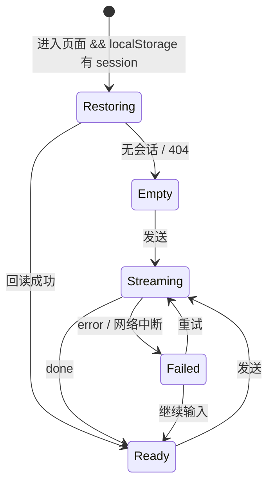

# 规格：App 对话页（Web）v1.1

- 状态：Frozen（v1.1 为无障碍增补）
- 日期：2026-11-07（v1.1：2026-11-20）
- 实现：`pet-lumina-app/src/views/chat/ChatView.vue` + `src/{api/sse.ts,api/agent.ts,utils/chatStream.ts}`
- 关联：[运行时 SPEC](agent-runtime-api.md) · [ADR-0006](../adr/0006-web-sse-client.md)

## 1. 范围

| 包含 | 不包含 |
| --- | --- |
| 单会话对话、流式渲染、工具/引用展示、错误重试、会话恢复 | 多会话列表与切换、语音输入、文件上传、消息点赞/反馈 |

## 2. 路由与布局

| 项 | 规则 |
| --- | --- |
| 路径 | `/chat`（`name: 'chat'`），挂在 `MainLayout` 下 |
| 入口 | 首页「问 Lumina」卡片（`Home.vue`）；`QuickActions.vue` 的按钮是历史遗留，未挂载 |
| 底部导航 | `route.name === 'chat'` 时**收起**（否则胶囊导航 `z-50` 会压住 `fixed bottom-0` 的输入区） |
| 滚动 | 消息区独立滚动，新消息/流式增量自动贴底；`no-scrollbar` 隐藏滚动条 |

## 3. 状态机

| 状态 | 界面 | 允许操作 |
| --- | --- | --- |
| `Restoring` | 骨架屏/空态不闪 | 输入框可用（发送会新建会话） |
| `Empty` | 欢迎卡 + 3 个建议问题 | 点建议、输入、开新会话 |
| `Ready` | 历史气泡 | 输入、发送、开新会话 |
| `Streaming` | 当前助手气泡 + `▍` 光标，发送按钮禁用 | 可滚动；不可重复发送 |
| `Failed` | 助手气泡保留已收内容 + 错误条（文案 + 重试） | 重试、继续输入、开新会话 |

## 4. 交互细则

| 场景 | 预期 |
| --- | --- |
| 发送 | 立即插入用户气泡 + 空助手气泡（`streaming=true`），随后 POST `/agent/chat` |
| `route` 事件 | 记录 `session_id` 并写 `localStorage['petlumina-agent-session']` |
| `tool` 事件 | 在助手气泡内追加 chip，文案 `chat.tool.<name>`，未知工具回落 `chat.tool.generic` |
| `delta` | 追加文本；光标跟随 |
| `done` | **用 `answer` 覆盖**气泡文本（防止拼接误差），落地 `citations`，`streaming=false` |
| `error` | 按 `error.code` 映射 `agentError.*`；若气泡为空则移除空气泡；错误条 `role=alert`，`retryable=true` 时给「重试」；未知 code 展示服务端 `message`，空 message 用 `agentError.unknown` |
| 重试 | 重发**最后一条用户消息**；失败气泡先清空再流式 |
| 404（会话不存在） | 静默清 `localStorage` 并新建会话，不打扰用户 |
| 401 / `unauthorized` | 清 `satoken`，跳 `/login`，toast `chat.loginExpired` |
| 网络中断 | 保留已收内容，显示 `agentError.network` + 重试 |
| 输入 | Enter 发送、Shift+Enter 换行；`event.isComposing` 为真时不发送（中文输入法） |
| 离开页面 | `AbortController.abort()`；不阻塞路由切换 |
| 新会话 | 清 `localStorage` 会话键 + 清空消息区，回到 `Empty` |

## 5. 引用（citation）渲染

| `kind` | 展示 | 点击 |
| --- | --- | --- |
| `log` | `link` 图标 + `label` | 跳 `/log/{id}` |
| 其他 | `description` 图标 + `label` | 无跳转（S2 接文档后再定义） |

## 6. 持久化

| 键 | 值 | 生命周期 |
| --- | --- | --- |
| `localStorage['petlumina-agent-session']` | session_id 字符串 | 手动「新会话」或收到 404 时清除 |
| `localStorage['satoken']` | Java 发的 token | 与全站一致，401 时清除 |

不缓存消息内容——历史以服务端 `GET /agent/sessions/{id}/messages` 为准（避免本地与服务端漂移）。

## 7. 文案（i18n）

`chat` 命名空间含基础 17 键（`title`、`subtitle`、`subtitlePet`、`placeholder`、`send`、`thinking`、`newChat`、`retry`、`emptyTitle`、`emptyBody`、`disclaimer`、`loginExpired`、`sendFailed`、`historyFailed`、`entry`、`entryHint`、`suggest.*`、`tool.*`）与 S1.35 新增的 `a11y.*`（`zh-CN` / `en-US` / `ja-JP` 同步）。

规则：新增可见文案必须先加三语键；`tool.*` 未覆盖的工具名回落 `chat.tool.generic`。

S1.36 起错误文案单独放 `agentError` 命名空间（20 键：`network`、`unauthorized`、`forbidden`、`notFound`、`invalidRequest`、`invalidArguments`、`toolNotAllowed`、`toolFailed`、`backendError`、`modelError`、`modelNotConfigured`、`runTimeout`、`budgetExceeded`、`rateLimited`、`rateLimitedWithRetry`、`circuitOpen`、`circuitOpenWithRetry`、`serverError`、`streamInterrupted`、`unknown`），映射规则见 `docs/spec/agent-runtime-api.md` 4.3.1。`*WithRetry` 用 `{seconds}` 插值（`retry_after_s` 向上取整）；已知 code 不再直接展示服务端中文 `message`。

## 8. 验收用例

| 编号 | 给 | 期望 |
| --- | --- | --- |
| W1 | 空会话发送"你好" | 出现 `route`→多个 `delta`→`done`；气泡文本等于 `done.answer` |
| W2 | 发送跨 chunk 的 SSE 文本 | 解析器正确拼回（`sse.spec.ts`） |
| W3 | 服务端 `error(model_error)` | 错误条显示 `agentError.modelError` 三语文案（不直接显示中文 message），可重试；run 状态 failed |
| W4 | 刷新页面 | 回读历史，顺序与条数一致 |
| W5 | 服务端返回 404（会话过期） | 自动换新会话，无报错弹窗 |
| W6 | 401 | 跳登录并清 token |
| W7 | 中文输入法按 Enter 选词 | 不触发发送 |
| W8 | 对话页打开 | 底部导航隐藏，输入框完整可见 |
| W9 | 服务端 `error(rate_limited, detail.retry_after_s=37)`，英文界面 | 错误条为 `Too many requests. Try again in 37 seconds.`，不出现服务端中文 message |

## 9. 变更记录

| 版本 | 日期 | 变更 |
| --- | --- | --- |
| v1.0 | 2026-11-07 | 初版：随 S1.5 Web 接入冻结 |
| v1.1 | 2026-11-20 | S1.35 补无障碍基线（D9）：状态播报区、消息区语义、错误 `alert`、输入框名称、`h1`、历史面板焦点闭环 |
| v1.2 | 2026-11-21 | S1.36 错误文案按 `code` 三语化（D8）：`agentError.*` 20 键、`retry_after_s` 向上取整、未知 code 回退服务端 message；补 W9 |

## 10. 无障碍基线（S1.35）

| 项 | 规则 |
| --- | --- |
| 消息区 | `role="region"` + `:aria-label="chat.a11y.logLabel"` + `tabindex="0"`；流式期间 `aria-busy="true"`，流结束/失败回到 `"false"` |
| 播报 | 独立 `role="status"`（`aria-live="polite"`、`aria-atomic="true"`、`sr-only`）节点，只播 `chat.a11y.replyStarted` / `chat.a11y.replyDone`；流式 `delta` 不播报 |
| 错误 | 错误条 `role="alert"`（含错误文案与重试按钮） |
| 输入 | `aria-label=chat.a11y.inputLabel`；`aria-describedby` 指向 `#chat-disclaimer` |
| 标题 | 页面唯一 `h1`（Lumina） |
| 历史面板 | `role="dialog"` + `aria-modal="true"` + `tabindex="-1"`；打开后焦点进入容器；`Tab` / `Shift+Tab` 在面板内循环；`Esc` / 遮罩 / 关闭按钮退出；关闭后焦点回到触发按钮 |
| 视觉 | 仅新增 `sr-only` 节点与 ARIA 属性，不改布局、颜色与动效 |

验收：`pet-lumina-app/src/views/chat/ChatView.a11y.spec.ts`（6 例，含焦点闭环与 `aria-busy` 生命周期）。真实读屏软件（NVDA/VoiceOver）的人工验收不在自动化范围内。
